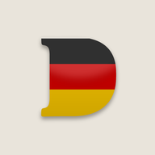

# Täglich Wort - The Daily German App

**Täglich Wort** by [Daily Deutsch](https://github.com/dailydeutsch): one German word a day (Wort des Tages), with its forms, examples in context and a short test. Learn German vocabulary, one word daily.

Live: https://dailydeutsch.github.io/

## What this is

- 365 words, one for every day of the year. Day 1 is taugen, Days 2 to 43 are a cooking set.
- A progressive web app: installable on iOS, Android, tablet and desktop, with offline caching.
- Minimalist design: the main word in Vollkorn bold serif, everything else in Inter, on a gentle grey tint of beige.
- SEO: title and meta description carry the German word of the day keywords (German word of the day, Wort des Tages), Open Graph and Twitter cards with a 1200x630 image, WebApplication structured data, canonical URL, robots.txt, sitemap.xml and a branded 404 page.

## Files

- `index.html` - the app (single self-contained page, exported from the Muse artifact daily-german)
- `manifest.webmanifest` - PWA manifest
- `sw.js` - service worker (versioned cache, network-first for navigation, cache-first for static assets and Google Fonts)
- `robots.txt`, `sitemap.xml`, `404.html` - search and error handling
- `og-image.png` - Open Graph / Twitter share image (1200x630, built from the Daily Deutsch logo)
- `dailydeutsch-logo-192.png`, `dailydeutsch-logo-512.png`, `dailydeutsch-logo-1024.png` - app icons
- `apple-touch-icon.png`, `favicon-64.png` - platform icons

Local canonical copy: ~/workspace/dailydeutsch/site/
